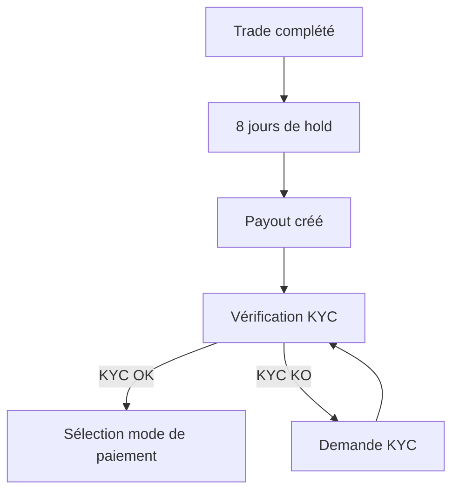

# Intégration GateFi (Unlimit Crypto)

Ce document décrit l'intégration de GateFi pour les paiements SEPA et crypto sur la plateforme CashTrade.

## 📋 Table des matières

- [Vue d'ensemble](#vue-densemble)
- [Architecture](#architecture)
- [Configuration](#configuration)
- [Flux de paiement](#flux-de-paiement)
- [KYC avec Sumsub](#kyc-avec-sumsub)
- [API Routes](#api-routes)
- [Composants UI](#composants-ui)
- [Webhooks](#webhooks)
- [Sécurité](#sécurité)
- [Tests](#tests)

## Vue d'ensemble

GateFi (Unlimit Crypto) est utilisé pour gérer deux types de paiements :

### OffRamp (SEPA)
- **Objectif** : Convertir de la crypto en EUR et payer via virement SEPA
- **Délai** : 1-3 jours ouvrés
- **Frais** : ~0.5% + frais de traitement GateFi
- **Crypto supportées** : ETH, USDC, USDT

### OnRamp (Crypto)
- **Objectif** : Envoyer des crypto directement sur le wallet de l'utilisateur
- **Délai** : Variable selon la blockchain (quelques minutes à 1h)
- **Frais** : Frais réseau variables
- **Crypto supportées** : ETH, USDC, USDT, BTC

## Architecture

```
┌─────────────┐
│   Utilisateur│
└──────┬──────┘
       │
       ▼
┌─────────────────────┐
│  Frontend (Next.js) │
│  - Payment Selector │
│  - SEPA/Crypto Form │
│  - GateFi Widget    │
└──────┬──────────────┘
       │
       ▼
┌──────────────────────┐
│  API Routes (Next)   │
│  /api/gatefi/*       │
└──────┬───────────────┘
       │
       ├─────────┬─────────────┐
       ▼         ▼             ▼
┌──────────┐ ┌──────────┐ ┌──────────┐
│ OffRamp  │ │ OnRamp   │ │   KYC    │
│ Service  │ │ Service  │ │ Service  │
└──────┬───┘ └────┬─────┘ └────┬─────┘
       │          │             │
       ▼          ▼             ▼
┌─────────────────────────────────┐
│      GateFi API / Sumsub API    │
└─────────────────────────────────┘
```

## Configuration

### Variables d'environnement

Créez un fichier `.env.local` avec les variables suivantes :

```bash
# GateFi
GATEFI_API_KEY_PUBLIC=your-public-key
GATEFI_API_KEY_PRIVATE=your-private-key
GATEFI_PARTNER_ACCOUNT_ID=your-partner-id
GATEFI_WEBHOOK_SECRET=your-webhook-secret
GATEFI_ENVIRONMENT=sandbox # ou 'production'

# Sumsub KYC
SUMSUB_APP_TOKEN=your-app-token
SUMSUB_SECRET_KEY=your-secret-key
SUMSUB_BASE_URL=https://api.sumsub.com
SUMSUB_LEVEL_NAME=basic-kyc-level
```

### Base de données

Appliquez la migration Prisma :

```bash
npx prisma migrate dev
```

Les champs suivants ont été ajoutés au modèle `Payout` :
- `gateFiOrderId` : ID unique de la commande GateFi
- `gateFiWidgetUrl` : URL du widget GateFi pour compléter le paiement

L'enum `PaymentMethodType` a été mis à jour :
- `SEPA` : Virement SEPA
- `CRYPTO` : Paiement crypto
- ~~`STRIPE`~~ : Supprimé

## Flux de paiement

### 1. Après le Trade Hold (8 jours)



### 2. Paiement SEPA

```typescript
// 1. Obtenir un devis
const quoteResponse = await fetch('/api/gatefi/offramp/quote', {
  method: 'POST',
  body: JSON.stringify({
    fiatAmount: 10000, // 100 EUR en centimes
    crypto: 'USDC',
    region: 'FR',
  }),
});

// 2. Initier le paiement
const sellResponse = await fetch('/api/gatefi/offramp/sell', {
  method: 'POST',
  body: JSON.stringify({
    payoutId: 'payout_123',
    amountCents: 10000,
    cryptoAmount: quote.amountIn,
    crypto: 'USDC',
    region: 'FR',
  }),
});

// 3. Rediriger vers le widget GateFi
window.location.href = sellResponse.redirectUrl;
```

### 3. Paiement Crypto

```typescript
// 1. Obtenir un devis
const quoteResponse = await fetch('/api/gatefi/onramp/quote', {
  method: 'POST',
  body: JSON.stringify({
    fiatAmount: 10000, // 100 EUR équivalent
    crypto: 'USDT',
    region: 'FR',
  }),
});

// 2. Initier le paiement
const buyResponse = await fetch('/api/gatefi/onramp/buy', {
  method: 'POST',
  body: JSON.stringify({
    payoutId: 'payout_123',
    amountCents: 10000,
    crypto: 'USDT',
    region: 'FR',
    walletAddress: '0x...',
  }),
});

// 3. Rediriger vers le widget GateFi
window.location.href = buyResponse.redirectUrl;
```

## KYC avec Sumsub

### Configuration KYC

Le KYC est obligatoire avant tout paiement. Nous utilisons Sumsub intégré avec GateFi.

### Vérification du statut

```typescript
const response = await fetch('/api/gatefi/kyc/status');
const { kycStatus, isVerified } = await response.json();

if (isVerified) {
  // L'utilisateur peut effectuer des payouts
} else {
  // Afficher le composant KYC
}
```

### Génération du token

```typescript
const response = await fetch('/api/gatefi/kyc/status', {
  method: 'POST',
});
const { token } = await response.json();

// Le token est partagé avec GateFi lors de l'initiation du paiement
```

### Webhooks Sumsub

Les webhooks Sumsub mettent à jour automatiquement le statut KYC :

```
POST /api/gatefi/webhooks
Headers:
  x-signature: <signature>
  x-webhook-type: sumsub
```

## API Routes

### Configuration

```
GET /api/gatefi/configuration?type=offramp|onramp|all
```

### OffRamp (SEPA)

```
POST /api/gatefi/offramp/quote
POST /api/gatefi/offramp/sell
GET  /api/gatefi/offramp/orders/[orderId]
```

### OnRamp (Crypto)

```
POST /api/gatefi/onramp/quote
POST /api/gatefi/onramp/buy
GET  /api/gatefi/onramp/orders/[orderId]
```

### KYC

```
GET  /api/gatefi/kyc/status
POST /api/gatefi/kyc/status (génère un token)
```

### Webhooks

```
POST /api/gatefi/webhooks
```

## Composants UI

### PaymentMethodSelector

Permet à l'utilisateur de choisir entre SEPA et Crypto.

```tsx
import { PaymentMethodSelector } from '@/components/payment/payment-method-selector';

<PaymentMethodSelector
  onSelect={(method) => setSelectedMethod(method)}
  selectedMethod="SEPA"
/>
```

### SepaPaymentForm

Formulaire pour initier un paiement SEPA.

```tsx
import { SepaPaymentForm } from '@/components/payment/sepa-payment-form';

<SepaPaymentForm
  payoutId="payout_123"
  amountCents={10000}
  onSuccess={(url) => window.location.href = url}
  onError={(error) => console.error(error)}
/>
```

### CryptoPaymentForm

Formulaire pour initier un paiement crypto.

```tsx
import { CryptoPaymentForm } from '@/components/payment/crypto-payment-form';

<CryptoPaymentForm
  payoutId="payout_123"
  amountCents={10000}
  onSuccess={(url) => window.location.href = url}
  onError={(error) => console.error(error)}
/>
```

### GateFiWidget

Modal contenant l'iframe du widget GateFi.

```tsx
import { GateFiWidget } from '@/components/payment/gatefi-widget';

<GateFiWidget
  isOpen={isWidgetOpen}
  onClose={() => setIsWidgetOpen(false)}
  widgetUrl={widgetUrl}
  payoutId="payout_123"
  onSuccess={() => console.log('Payment completed')}
/>
```

### PayoutStatusTracker

Timeline de suivi du paiement.

```tsx
import { PayoutStatusTracker } from '@/components/payment/payout-status-tracker';

<PayoutStatusTracker
  payoutId="payout_123"
  orderId="gatefi_order_123"
  orderType="SEPA"
  currentStatus="PROCESSING"
  autoRefresh={true}
/>
```

### KycVerification

Composant de vérification KYC.

```tsx
import { KycVerification } from '@/components/payment/kyc-verification';

<KycVerification
  onVerificationComplete={() => console.log('KYC verified')}
/>
```

## Webhooks

### Configuration

Configurez les webhooks dans votre compte GateFi et Sumsub :

**GateFi:**
```
URL: https://votredomaine.com/api/gatefi/webhooks
Headers:
  x-signature: <généré par GateFi>
  x-webhook-type: gatefi
```

**Sumsub:**
```
URL: https://votredomaine.com/api/gatefi/webhooks
Headers:
  x-signature: <généré par Sumsub>
  x-webhook-type: sumsub
```

### Événements traités

#### GateFi
- `COMPLETED` : Paiement complété
- `FAILED` : Paiement échoué
- `EXPIRED` : Commande expirée
- `PROCESSING` : Paiement en cours

#### Sumsub
- `GREEN` : KYC approuvé
- `RED` : KYC rejeté
- `YELLOW` : KYC en attente de révision

## Sécurité

### Signatures HMAC

Toutes les requêtes vers l'API GateFi sont signées avec HMAC-SHA256 :

```typescript
import { generateSignature } from '@/lib/gatefi';

const queryString = 'partnerAccountId=xxx&amount=100&...';
const signature = generateSignature(queryString, privateKey);
```

### Validation des webhooks

```typescript
import { validateWebhookSignature } from '@/lib/gatefi';

const isValid = validateWebhookSignature(payload, signature);
if (!isValid) {
  return res.status(401).json({ error: 'Invalid signature' });
}
```

### KYC obligatoire

```typescript
import { canUserMakePayout } from '@/lib/gatefi-kyc';

const { allowed, reason } = await canUserMakePayout(userId);
if (!allowed) {
  return res.status(403).json({ error: reason });
}
```

## Tests

### Tests en sandbox

Utilisez l'environnement sandbox de GateFi :

```bash
GATEFI_ENVIRONMENT=sandbox
```

### Cartes de test

GateFi fournit des cartes de test pour tester les paiements SEPA.

### Adresses de wallet de test

Pour les paiements crypto, utilisez des adresses de testnet :

- **Ethereum (Sepolia)** : `0x...`
- **Bitcoin (Testnet)** : `tb1...`

### Logs

Tous les événements sont loggués :

```typescript
console.log('[GateFi OffRamp] Transaction initiated:', { orderId, amount });
console.log('[GateFi OnRamp] Payment completed:', { orderId, txHash });
console.log('[KYC] User verified:', { userId, status });
```

## Support

Pour toute question ou problème :

- **Documentation GateFi** : https://docs.gatefi.com
- **Documentation Sumsub** : https://developers.sumsub.com
- **Support technique** : tech@cashtrade.com

---

**Version** : 1.0  
**Dernière mise à jour** : Novembre 2025

