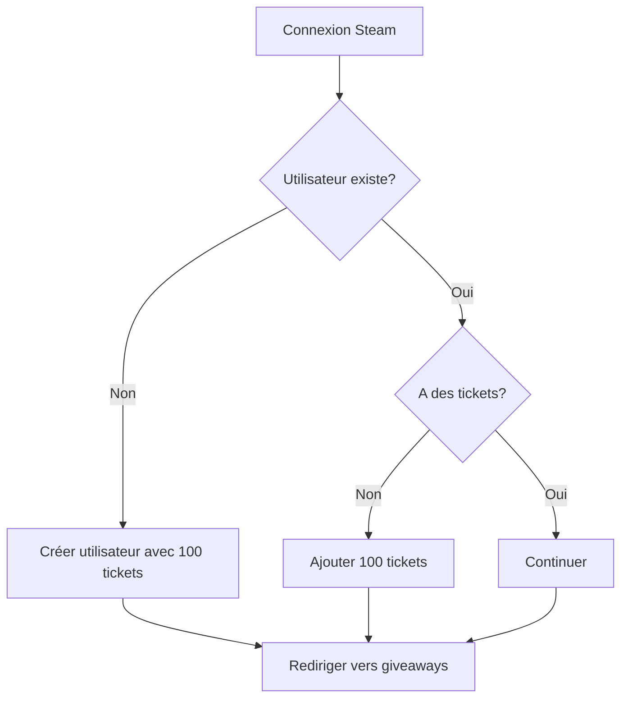
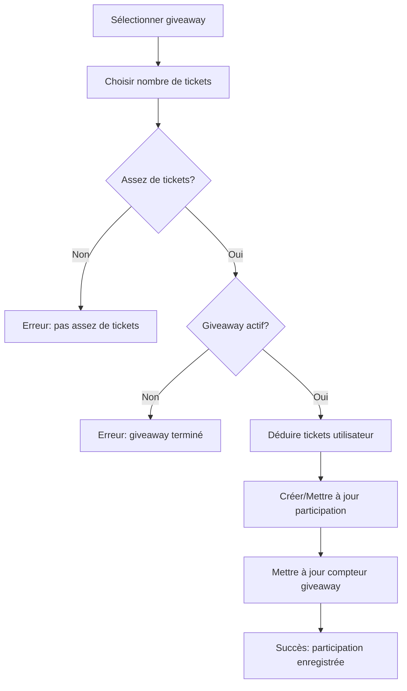
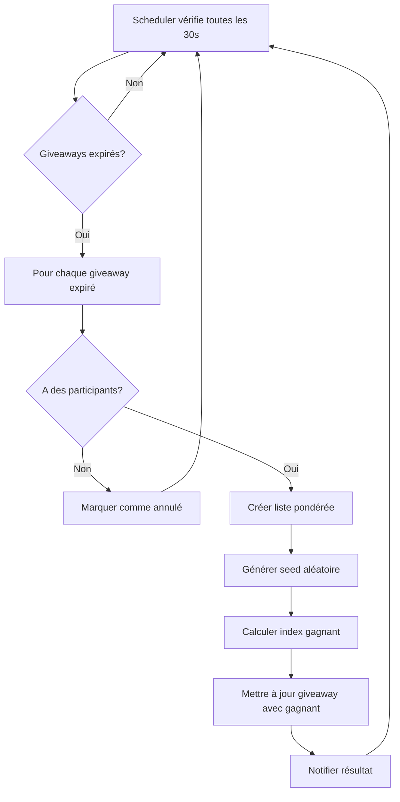

# Système de Giveaways Dynamique - MoonSkin

## Vue d'ensemble

Le système de giveaways de MoonSkin permet aux utilisateurs de participer à des concours en utilisant des tickets. Chaque nouvel utilisateur reçoit automatiquement 100 tickets lors de sa première connexion.

## Fonctionnalités Principales

### 🎫 Attribution Automatique de Tickets
- **100 tickets gratuits** pour chaque nouvel utilisateur
- Attribution lors de la première connexion Steam
- Stockage sécurisé en base de données

### 🎮 Giveaways Dynamiques
- Création automatique du premier giveaway (10 minutes de durée)
- Système de participation avec tickets
- Tirage automatique à l'expiration
- Résultats transparents et vérifiables

### 🏆 Tirage Automatique
- Vérification toutes les 30 secondes des giveaways expirés
- Algorithme de tirage pondéré (plus de tickets = plus de chances)
- Seed cryptographique pour la reproductibilité
- Notification en temps réel des résultats

### 📊 Interface Utilisateur
- Page principale avec giveaways actifs/terminés
- Page détaillée pour chaque giveaway
- Statistiques de participation
- Notifications en temps réel

## Architecture Technique

### Base de Données (Prisma)

```prisma
model User {
  tickets               Int                 @default(100) // 100 tickets initiaux
  giveawayEntries       GiveawayEntry[]
  // ... autres champs
}

model Giveaway {
  id          String          @id @default(cuid())
  title       String
  description String
  prize       String
  ticketPrice Int
  maxTickets  Int
  soldTickets Int             @default(0)
  endDate     DateTime
  status      GiveawayStatus  @default(ACTIVE)
  winnerId    String?
  randomSeed  String?
  entries     GiveawayEntry[]
}

model GiveawayEntry {
  id          String   @id @default(cuid())
  userId      String
  giveawayId  String
  ticketsUsed Int
  enteredAt   DateTime @default(now())
  
  @@unique([userId, giveawayId]) // Un utilisateur par giveaway
}
```

### APIs Créées

#### Giveaways
- `GET /api/giveaways` - Liste des giveaways (avec filtres)
- `POST /api/giveaways` - Créer un nouveau giveaway
- `GET /api/giveaways/[id]` - Détails d'un giveaway
- `POST /api/giveaways/[id]/participate` - Participer à un giveaway
- `POST /api/giveaways/[id]/draw` - Effectuer le tirage manuellement

#### Système Automatique
- `POST /api/giveaways/auto-draw` - Tirage automatique des giveaways expirés
- `GET /api/giveaways/auto-draw` - Vérifier les giveaways à tirer
- `POST /api/giveaways/init` - Initialiser le premier giveaway

#### Utilisateurs
- `GET /api/user/[id]` - Profil utilisateur avec participations
- `PATCH /api/user/[id]` - Mettre à jour l'utilisateur

#### Utilitaires
- `POST /api/seed` - Créer des données de test

### Composants React

#### Pages
- `src/app/giveaways/page.tsx` - Page principale des giveaways
- `src/app/giveaways/[id]/page.tsx` - Page détaillée d'un giveaway

#### Hooks
- `src/hooks/use-giveaways.ts` - Gestion des giveaways (CRUD, participation)

#### Services
- `src/lib/auto-draw-scheduler.ts` - Scheduler pour les tirages automatiques
- `src/lib/init-giveaway.ts` - Initialisation des données
- `src/lib/seed-giveaway.ts` - Données de test

#### Composants UI
- `src/components/giveaway/giveaway-notifications.tsx` - Notifications temps réel

## Flux Utilisateur

### 1. Première Connexion


### 2. Participation à un Giveaway


### 3. Tirage Automatique


## Configuration et Déploiement

### Variables d'Environnement
```env
DATABASE_URL="postgresql://..."
```

### Installation
```bash
# Installer les dépendances
npm install

# Configurer la base de données
npx prisma migrate deploy
npx prisma generate

# Démarrer l'application
npm run dev
```

### Initialisation des Données
```bash
# Créer le premier giveaway et utilisateur de test
curl -X POST http://localhost:3000/api/seed
```

## Sécurité et Conformité

### Anti-Fraude
- ✅ Un utilisateur ne peut participer qu'une fois par giveaway
- ✅ Vérification des tickets disponibles avant participation
- ✅ Transactions atomiques pour éviter les conditions de course
- ✅ Validation côté serveur de tous les paramètres

### Transparence
- ✅ Seed de tirage stocké et vérifiable
- ✅ Historique complet des participations
- ✅ Statistiques publiques de chaque giveaway
- ✅ Algorithme de tirage déterministe

### Performance
- ✅ Pagination des résultats
- ✅ Cache des requêtes fréquentes
- ✅ Optimisation des requêtes base de données
- ✅ Rafraîchissement automatique en arrière-plan

## Monitoring et Logs

### Événements Loggés
- Création de nouveaux utilisateurs avec tickets
- Participations aux giveaways
- Tirages automatiques
- Erreurs de validation
- Tentatives de fraude

### Métriques Importantes
- Nombre d'utilisateurs actifs
- Taux de participation aux giveaways
- Temps moyen entre création et fin de giveaway
- Distribution des tickets par utilisateur

## Évolutions Futures

### Phase 2
- [ ] Giveaways avec plusieurs prix
- [ ] Système de niveaux VIP avec bonus tickets
- [ ] Giveaways récurrents automatiques
- [ ] Intégration avec le système d'XP existant

### Phase 3
- [ ] Giveaways communautaires (financés par les utilisateurs)
- [ ] Système de parrainage avec tickets bonus
- [ ] API publique pour les partenaires
- [ ] Widgets intégrables

## Support et Maintenance

### Commandes Utiles
```bash
# Vérifier les giveaways expirés
curl http://localhost:3000/api/giveaways/auto-draw

# Forcer un tirage
curl -X POST http://localhost:3000/api/giveaways/auto-draw

# Créer un giveaway de test
curl -X POST http://localhost:3000/api/giveaways/init
```

### Résolution de Problèmes

**Problème : Les tirages ne se font pas automatiquement**
- Vérifier que le scheduler est actif dans les logs
- S'assurer que l'application n'est pas en mode développement avec rechargement à chaud

**Problème : Un utilisateur n'a pas reçu ses 100 tickets**
- Vérifier dans la base de données si l'utilisateur existe
- Utiliser l'API PATCH pour mettre à jour manuellement

**Problème : Erreur de participation**
- Vérifier que le giveaway est encore actif
- Contrôler que l'utilisateur a assez de tickets
- Examiner les logs pour les erreurs de transaction

---

*Système développé conformément aux règles MoonSkin v1.0 - Gamification et sécurité*