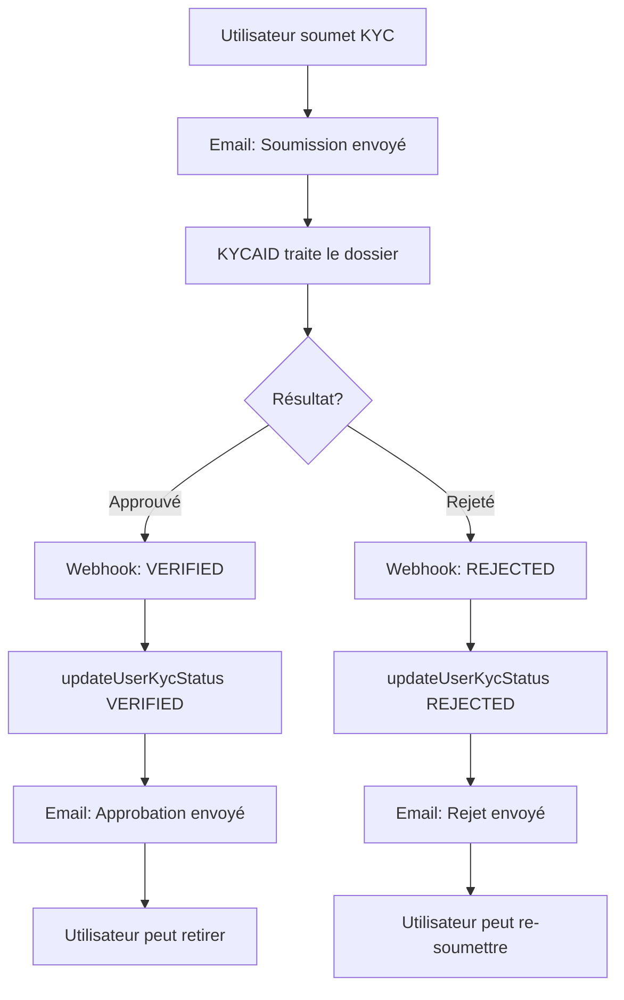

# 📧 Notifications Email KYC

Documentation complète du système de notifications email pour les processus KYC.

## 🎯 Vue d'ensemble

Le système envoie automatiquement des emails aux utilisateurs à chaque étape du processus KYC :
1. **Soumission** : Confirmation que le dossier est en cours de traitement
2. **Approbation** : Félicitations et déblocage des fonctionnalités premium
3. **Rejet** : Explication et conseils pour une nouvelle soumission

---

## 📬 Types d'emails

### 1. Email de soumission KYC ✅
**Trigger** : Immédiatement après la soumission du dossier KYC

**Fichier** : `/api/kyc/submit/route.ts`

**Contenu** :
- ✅ Confirmation de réception
- 📋 Détails de la soumission (date, statut)
- ⏳ Délai estimé (24-48h)
- 🔔 Lien vers le dashboard pour suivre l'état

**Code** :
```typescript
await emailService.sendKycSubmittedConfirmation(
  user.email,
  user.steamUsername || 'Utilisateur',
  submissionDate
);
```

---

### 2. Email d'approbation KYC 🎉
**Trigger** : Via webhook KYCAID quand le statut devient `VERIFIED`

**Fichier** : `src/lib/kycaid.ts` → `updateUserKycStatus()`

**Contenu** :
- 🎉 Message de félicitations
- ✅ Confirmation du compte vérifié
- 🎯 Liste des avantages débloqués :
  - Retraits illimités
  - Tous les modes de paiement
  - Support prioritaire
  - Sécurité renforcée
- 💰 Call-to-action : "Effectuez vos premiers retraits"
- 🔗 Lien vers le dashboard

**Code** :
```typescript
await emailService.sendKycApprovedEmail(
  user.email,
  username
);
```

---

### 3. Email de rejet KYC ⚠️
**Trigger** : Via webhook KYCAID quand le statut devient `REJECTED`

**Fichier** : `src/lib/kycaid.ts` → `updateUserKycStatus()`

**Contenu** :
- ⚠️ Message d'information (ton bienveillant)
- 📋 Raison détaillée du rejet
- 💡 Étapes à suivre pour corriger
- ✓ Conseils pratiques :
  - Documents clairs et lisibles
  - Photos de bonne qualité
  - Documents valides et à jour
- 🔗 Lien pour soumettre un nouveau dossier
- 🆘 Mention du support client

**Code** :
```typescript
await emailService.sendKycRejectedEmail(
  user.email,
  username,
  rejectionReason || 'Aucune raison spécifiée'
);
```

---

## 🔄 Flow complet



---

## 🏗️ Architecture

### Fichiers impliqués

1. **Templates** : `src/lib/email-templates.ts`
   ```typescript
   - kycSubmittedTemplate
   - kycApprovedTemplate
   - kycRejectedTemplate
   ```

2. **Service Email** : `src/lib/email.ts`
   ```typescript
   - sendKycSubmittedConfirmation()
   - sendKycApprovedEmail()
   - sendKycRejectedEmail()
   ```

3. **Logique KYC** : `src/lib/kycaid.ts`
   ```typescript
   - updateUserKycStatus() // Appelle les emails
   - processWebhook() // Reçoit les webhooks KYCAID
   ```

4. **API Routes**
   - `/api/kyc/submit` → Email de soumission
   - `/api/kycaid/webhook` → Emails d'approbation/rejet

---

## 🎨 Design des emails

Tous les emails suivent le même design system :

### Couleurs
- **Soumission** : Bleu (`#3b82f6`) - Information
- **Approbation** : Vert (`#10b981`) - Succès
- **Rejet** : Rouge (`#ef4444`) - Attention

### Structure
```html
<header> <!-- Gradient de couleur selon le type -->
  <h1>Titre principal avec emoji</h1>
  <p>Sous-titre</p>
</header>

<body>
  <p>Salutation personnalisée</p>
  
  <div class="info-card">
    <!-- Informations principales -->
  </div>
  
  <div class="action-card">
    <!-- Prochaines étapes -->
  </div>
  
  <button>Call-to-action</button>
  
  <div class="cs2-theme">
    <!-- Message de motivation -->
  </div>
</body>

<footer>
  <!-- Signature MoonSkin -->
</footer>
```

---

## 🔧 Configuration

### Variables d'environnement requises

```env
# SMTP (pour l'envoi d'emails)
SMTP_HOST=smtp.example.com
SMTP_PORT=587
SMTP_SECURE=false
SMTP_USER=noreply@moonskin.com
SMTP_PASSWORD=your_smtp_password
SMTP_FROM=MoonSkin <noreply@moonskin.com>

# KYCAID (pour les webhooks)
KYCAID_API_TOKEN=your_api_token
KYCAID_WEBHOOK_SECRET=your_webhook_secret
KYCAID_BASE_URL=https://api.kycaid.com

# App
NEXT_PUBLIC_APP_URL=https://moonskin.com
```

---

## 🧪 Testing

### Test manuel - Soumission
```bash
# Soumettre un dossier KYC via l'interface
# Vérifier la réception de l'email de confirmation
```

### Test manuel - Approbation
```bash
# Simuler un webhook KYCAID avec statut VERIFIED
curl -X POST http://localhost:3000/api/kycaid/webhook \
  -H "Content-Type: application/json" \
  -d '{
    "type": "VERIFICATION_COMPLETED",
    "applicant_id": "APP_ID",
    "verification_id": "VER_ID",
    "verified": true,
    "status": "completed"
  }'
```

### Test manuel - Rejet
```bash
# Simuler un webhook KYCAID avec statut REJECTED
curl -X POST http://localhost:3000/api/kycaid/webhook \
  -H "Content-Type: application/json" \
  -d '{
    "type": "VERIFICATION_COMPLETED",
    "applicant_id": "APP_ID",
    "verification_id": "VER_ID",
    "verified": false,
    "status": "declined",
    "decline_reasons": ["Document non lisible", "Photo de mauvaise qualité"]
  }'
```

---

## 🔒 Sécurité

### Gestion des erreurs
- Les erreurs d'envoi d'email ne bloquent **jamais** le processus KYC
- Chaque erreur est loggée mais n'empêche pas la mise à jour du statut
- Mode **non-bloquant** : `try/catch` autour de chaque envoi

### Protection des données
- Aucun mot de passe ou donnée sensible dans les emails
- Uniquement des informations nécessaires (nom, statut, raisons)
- Les emails sont envoyés uniquement si l'utilisateur a un email en base

### Logs
```typescript
console.log(`📧 [KYCAID] Envoi de l'email d'approbation KYC à ${email}`);
console.log(`✅ [KYCAID] Email envoyé avec succès`);
console.error(`⚠️  [KYCAID] Erreur email (non bloquant) :`, error);
```

---

## 📊 Monitoring

### Métriques à surveiller
- ✅ Taux d'envoi réussi
- ⏱️ Temps moyen d'envoi
- 📧 Bounces / emails non délivrés
- 👁️ Taux d'ouverture
- 🖱️ Taux de clic (CTA vers dashboard)

### Logs importants
```
✅ [KYC SUBMIT] Email de confirmation envoyé à user@example.com
📧 [KYCAID] Envoi de l'email d'approbation KYC à user@example.com
✅ [KYCAID] Email d'approbation KYC envoyé avec succès
```

---

## 🌐 Internationalisation

### Statut actuel
- Emails en **français** uniquement
- Templates prêts pour l'internationalisation

### Future extension
Pour ajouter l'anglais :
1. Dupliquer les templates avec suffixe `_en`
2. Ajouter une logique de détection de langue utilisateur
3. Appeler le bon template selon la langue

Exemple :
```typescript
const lang = user.language || 'fr';
const template = lang === 'en' 
  ? kycApprovedTemplateEn 
  : kycApprovedTemplate;
```

---

## ✅ Checklist de déploiement

Avant de déployer en production :

- [ ] Variables SMTP configurées
- [ ] SMTP testé et fonctionnel
- [ ] Webhook KYCAID configuré avec la bonne URL
- [ ] `KYCAID_WEBHOOK_SECRET` défini
- [ ] Test de soumission KYC complet
- [ ] Test de réception des 3 types d'emails
- [ ] Vérification des logs dans la console
- [ ] Validation du design sur différents clients email (Gmail, Outlook, etc.)
- [ ] Test de tous les liens (dashboard, KYC, etc.)

---

## 🐛 Troubleshooting

### Email de soumission non reçu
1. Vérifier les logs : `✅ [KYC SUBMIT] Email de confirmation envoyé`
2. Vérifier la configuration SMTP
3. Vérifier que l'utilisateur a bien un email en base

### Email d'approbation/rejet non reçu
1. Vérifier que le webhook KYCAID est bien reçu
2. Vérifier les logs : `📧 [KYCAID] Envoi de l'email`
3. Vérifier que `updateUserKycStatus` est appelé
4. Vérifier que l'utilisateur a un email

### Email envoyé mais non reçu
1. Vérifier les spams
2. Vérifier les bounces SMTP
3. Tester avec un autre email
4. Vérifier les logs SMTP du serveur

---

## 📚 Ressources

- [Documentation Nodemailer](https://nodemailer.com/)
- [Documentation KYCAID Webhooks](https://docs.kycaid.com/)
- [Email Templates Best Practices](https://www.litmus.com/)

---

## 🎉 Résultat

**Le système est maintenant 100% fonctionnel et automatique !**

Chaque utilisateur reçoit :
1. ✅ Un email immédiat après soumission
2. 🎉 Un email de félicitations si approuvé
3. ⚠️ Un email d'aide si rejeté

**Tous les emails sont magnifiques, responsive et cohérents avec le design MoonSkin CS2 !** 🎮✨
